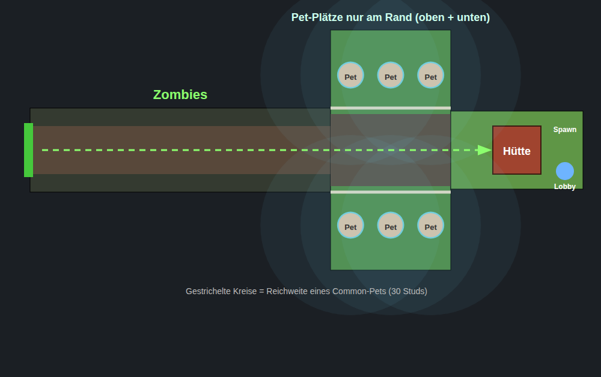

# Roll a Pet – Zombie-Modus

Zombies kommen links aus dem Tor und laufen zur Hütte rechts. Pets kann man
**nur auf den 6 Plätzen am Rand** (3 oben, 3 unten) im Mittelteil platzieren.

## Installieren (ohne Rojo)

1. `dist/ZombieDefense.rbxmx` herunterladen und in Roblox Studio ins Fenster ziehen.
   Es erscheint ein Ordner `ZombieDefense_Installieren` mit drei Unterordnern.
2. Den Inhalt verschieben:
   - `1_in_ReplicatedStorage/ZombieDefense` → **ReplicatedStorage**
   - `2_in_ServerScriptService/ZombieDefense` → **ServerScriptService**
   - `3_in_StarterPlayerScripts/ZombieDefenseClient` → **StarterPlayer → StarterPlayerScripts**
3. Den leeren Ordner `ZombieDefense_Installieren` löschen.
4. Das alte Zombie-System deaktivieren, damit sich nichts doppelt.
5. Auf Play drücken und durch das grüne Portal „🧟 Zombie-Modus“ laufen.

Mit Rojo: `rojo serve` (nutzt `default.project.json`).

## Anpassen

Alles steht in `ReplicatedStorage/ZombieDefense/Config`:

| Was | Wo in Config |
| --- | --- |
| Name der Währung (leaderstats) | `Economy.CurrencyName` |
| Wenig Geld bis Welle 50 (Welle 1 = 10 %, ab Welle 50 = 100 %) | `Economy.EarlyGameMultiplier`, `Economy.EarlyGameRampWaves`, `Economy.EarlyGameCurve` |
| Wie schnell Zombies stärker werden | `Waves.HealthGrowthPerWave`, `Waves.HealthGrowthQuadratic` |
| Sounds (IDs, Lautstärke, Tonhöhe) | `Sounds.List` |
| Coins pro Zombie | `Economy.KillReward` |
| Position der Map / des Portals | `Map.Origin`, `Map.LobbyPortalPosition` |
| Anzahl der Rand-Plätze | `Map.SlotsPerSide` |
| Max. Pets pro Spieler | `PetPlacement.MaxPetsPerPlayer` |
| Pets mit Seltenheit und Element | `Pets` |
| Stärke pro Seltenheit | `Rarities` |

### Eigene Pets anbinden

`ServerScriptService/ZombieDefense/PetInventory` liest die Pets aus dem Ordner
`player.Pets`. Wenn deine Pets woanders gespeichert sind, passe nur
`PetInventory.GetPets` an. Pet-Models werden in `ReplicatedStorage/PetModels`
oder `ServerStorage/PetModels` (bzw. `Pets`) gesucht; ohne Model gibt es ein
buntes Platzhalter-Pet. Ein Model kann die Attribute `Rarity` und `Element` haben.

## Geld-System (fair für neue und alte Spieler)

- Bis Welle 50 gibt es wenig Geld (10 % → 100 %).
- Die Belohnung richtet sich nach den Wellen, die **du selbst** in der Runde
  geschafft hast. Wer bei Welle 45 dazukommt, bekommt trotzdem erst 10 %.
- Kill-Coins werden nach Schaden aufgeteilt, niemand kann Kills klauen.
- Den Wellen-Bonus gibt es nur, wenn deine Pets in der Welle mitgekämpft haben.
- Wer die Map ohne platzierte Pets verlässt, verliert seinen Fortschritt.
- Im HUD steht „💰 Diese Runde“ und der aktuelle Belohnungs-Anteil.

Grobe Simulation, wie weit man kommt: 2 Common ≈ Welle 6, 3 Legendary ≈ Welle 33,
3 Mythic ≈ Welle 55, 6 Mythic (2 Spieler) ≈ Welle 90.

## Sounds

Eingetragen sind eingebaute Roblox-Sounds (`rbxasset://sounds/...`), damit es
sofort klingt. Bessere Sounds: in der Toolbox unter Audio suchen, die ID kopieren
und in `Config.Sounds.List` als `Id = "rbxassetid://..."` eintragen. Sounds, die
nicht laden, werden übersprungen.

## Effekte

Elemente: ⭐ Normal, 🔥 Feuer (brennt nach), ❄️ Eis (verlangsamt),
⚡ Blitz (springt auf 2 weitere Zombies), ✨ Magie (Flächenschaden).

- Mündungsblitz und kleiner Rückstoß beim Schießen
- Geschoss mit Schweif und Partikeln (Eis-Splitter, Feuerball, Magie-Spirale, Zickzack-Blitz)
- Treffer: Lichtblitz, Partikel-Burst, Schockwellen-Ring, Speed-Lines bei Krits
- Schadenszahlen (Krit = „KRIT!“) und Coin-Pop beim Kill
- Aura nach Seltenheit: Funken → Licht → Lichtsäule + Umriss (Legendary) → Regenbogen + kreisende Kugeln (Mythic)
- Zombies: Laufanimation, Aufblitzen bei Treffer, blau bei Eis, Flammen bei Feuer, Auflösen + Geist beim Tod
- Hütte: Holzsplitter, Staub und Kamera-Wackeln
